# MY Academy Portfolio Project

ASP.NET Core MVC ve Entity Framework Core kullanılarak geliştirilen dinamik kişisel portfolyo ve yönetim paneli projesidir. Proje kapsamında kullanıcıların kişisel bilgileri, yetenekleri, deneyimleri, eğitimleri ve projeleri görüntüleyebileceği modern bir web arayüzü hazırlanmıştır. Ayrıca tüm içeriklerin yönetilebildiği dinamik bir Admin Paneli geliştirilmiştir.

## 🚀 Kullanılan Teknolojiler

- **C#** – Backend geliştirme
- **ASP.NET Core MVC (.NET 9)** – Web uygulaması mimarisi
- **Entity Framework Core 9** – ORM ve veritabanı işlemleri
- **SQL Server** – Veritabanı yönetimi
- **Code First** – Veritabanı oluşturma ve migration işlemleri
- **HTML5 & CSS3** – Sayfa yapısı ve tasarım
- **Bootstrap 5** – Responsive arayüz
- **JavaScript** – Dinamik kullanıcı etkileşimleri
- **Bootstrap Icons** – İkon kullanımı
- **SweetAlert2** – Bildirim ve onay pencereleri

## 🌐 Kullanıcı Arayüzü (User Interface)

Kullanıcı arayüzü, portfolyo sahibinin kendisini, teknik yeteneklerini ve çalışmalarını ziyaretçilere tanıtmasını sağlar.

### 1. Ana Sayfa

Kişisel karşılama alanı, dinamik başlıklar, tanıtım metni ve yönlendirme bağlantıları bulunmaktadır.

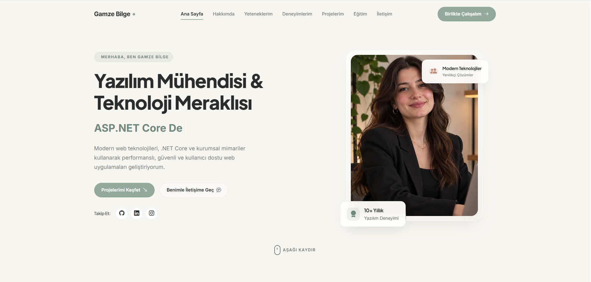

### 2. Hakkımda

Portfolyo sahibinin kişisel tanıtım bilgileri ve hakkında bölümü görüntülenir.

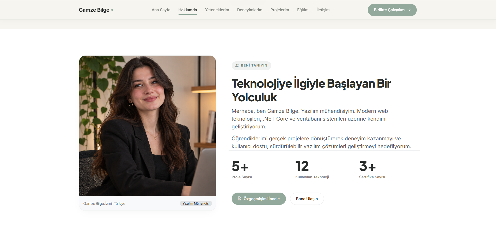

### 3. Yeteneklerim

Teknik yetenekler, açıklamaları, ikonları ve yetenek seviyeleri görüntülenir.

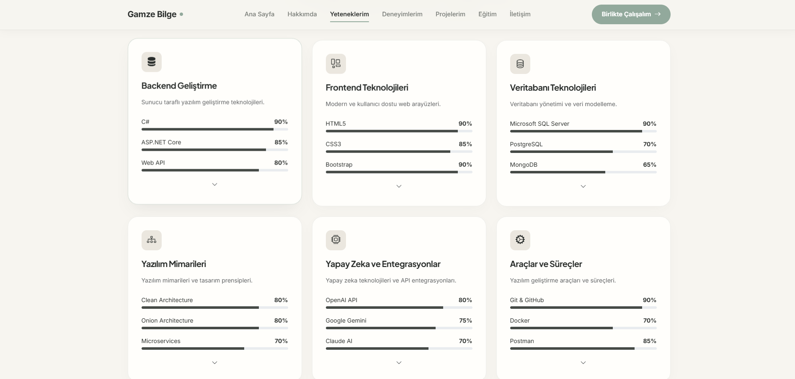

### 4. Deneyimlerim

İş ve mesleki deneyimler listelenir.

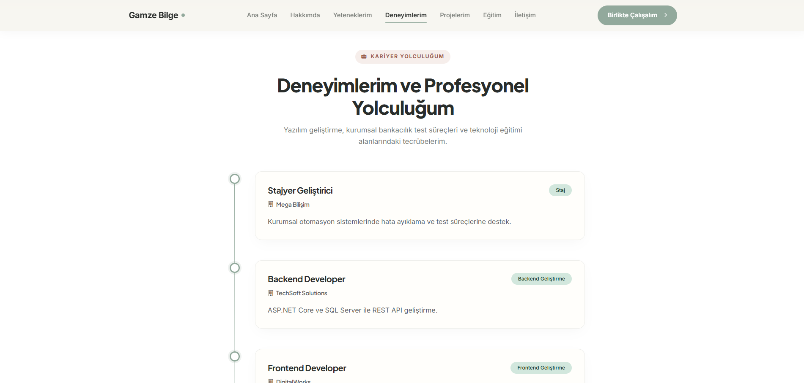

### 5. Projelerim

Geliştirilen projeler; proje adı, açıklaması, görseli, teknolojileri ve kategorileriyle birlikte sunulur. Kategori filtreleme özelliği bulunur.

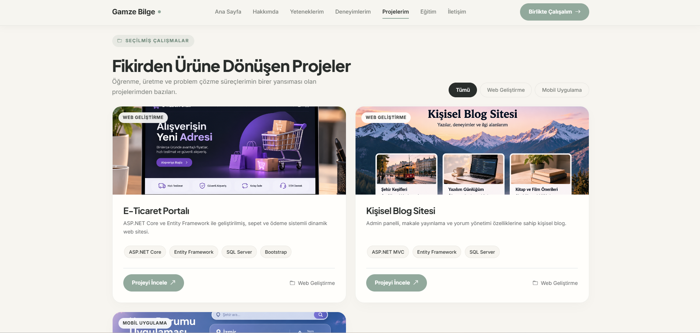

### 6. Eğitim Bilgileri

Eğitim geçmişi ve ilgili açıklamalar ziyaretçilere sunulur.

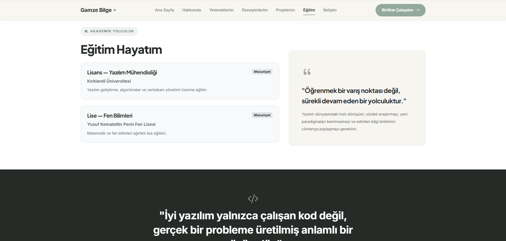

### 7. İletişim

E-posta, konum ve sosyal medya bağlantıları görüntülenir. Ziyaretçiler iletişim formu aracılığıyla mesaj gönderebilir.

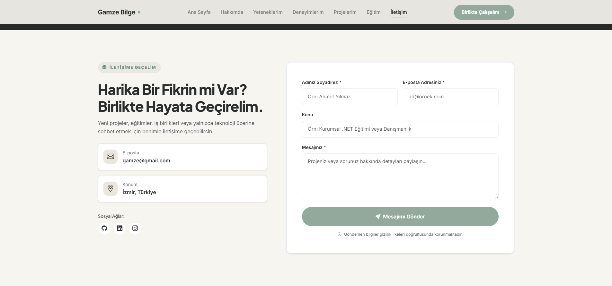

---

## ⚙️ Admin Paneli

Admin Paneli, portfolyo içeriğinin yönetilebildiği dinamik bir yönetim arayüzüdür. Kullanıcı arayüzünde görüntülenen içerikler yönetim paneli üzerinden güncellenebilir.

### 1. Dashboard

Projeler, yetenekler, deneyimler, eğitimler ve mesajlara ait istatistikler görüntülenir.

Dashboard içerisinde:
- Toplam proje sayısı
- Aktif proje sayısı
- Yetenek sayısı
- Deneyim sayısı
- Eğitim sayısı
- Toplam mesaj sayısı
- Okunmamış mesaj sayısı
- Kategori özeti
- Son projeler
- Son mesajlar
- Hızlı erişim bağlantıları

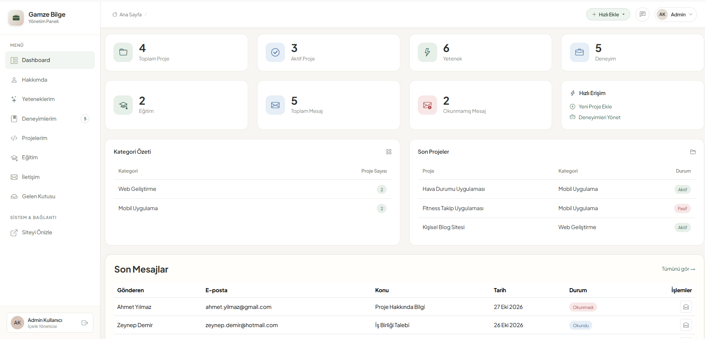

### 2. Hakkımda ve Ana Sayfa İçerikleri

Ana sayfanın karşılama alanı ve Hakkımda bölümü yönetilir. İçerikler Admin Paneli üzerinden güncellenebilir.

**Ana Sayfa İçerikleri**

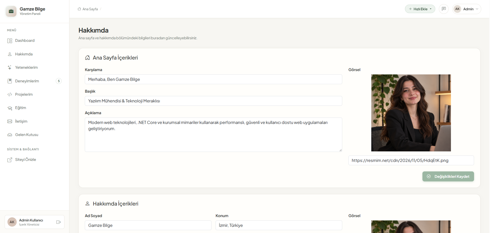

**Hakkımda İçerikleri**

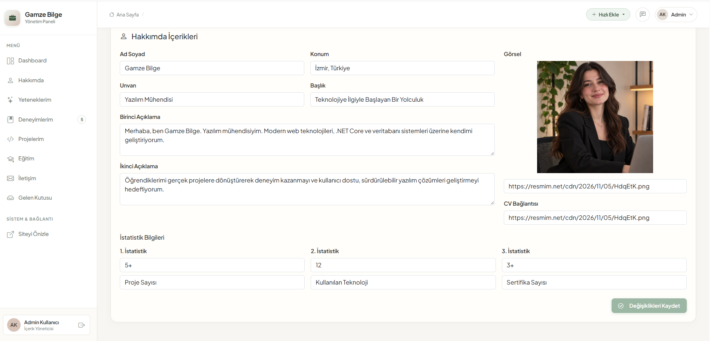

### 3. Deneyim Yönetimi

Deneyim kayıtları listelenir ve yönetilir.

- Deneyim ekleme
- Deneyim güncelleme
- Deneyim silme
- Aktif ve pasif durum yönetimi
- Toplu işlem
- Sayfalama

**Deneyim Listesi**

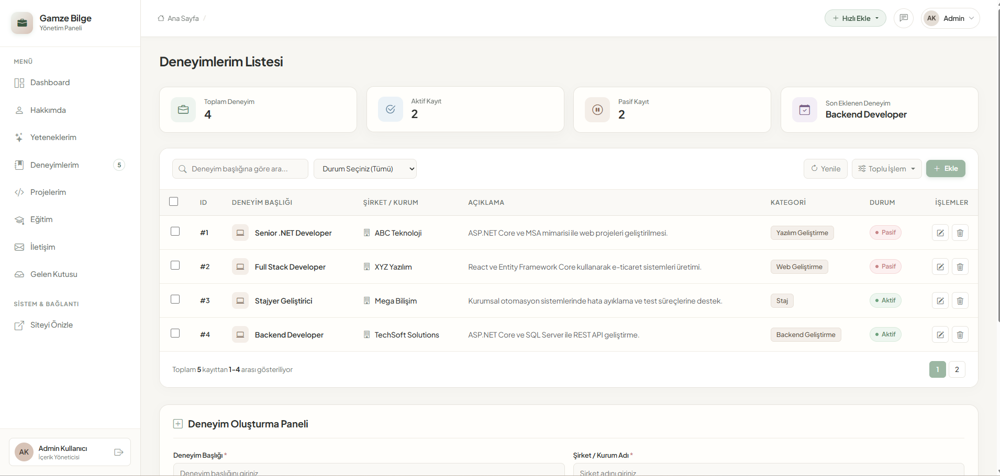

**Deneyim Ekleme**

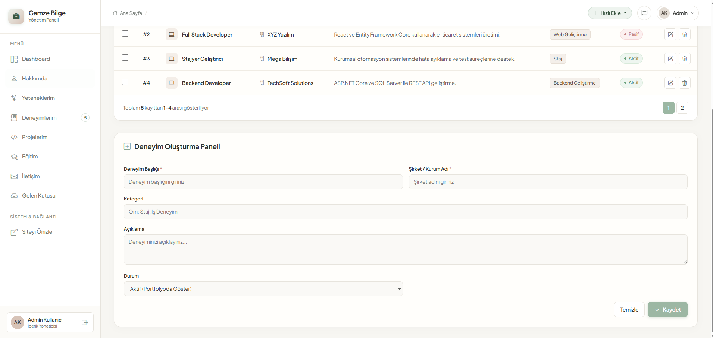

**Deneyim Güncelleme**

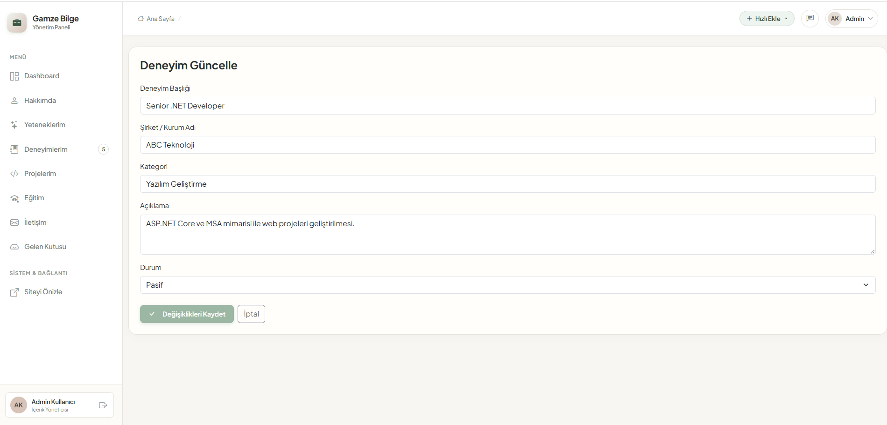

### 4. Yetenek Yönetimi

Yetenek kategorileri ve bunlara bağlı yetenek maddeleri yönetilir.

- Yetenek kategorisi ekleme
- Yetenek bilgilerini güncelleme
- Yetenek silme
- Yetenek açıklaması ve ikon yönetimi
- Yetenek maddeleri ve seviyelerinin yönetimi

- **Yetenek Listesi**

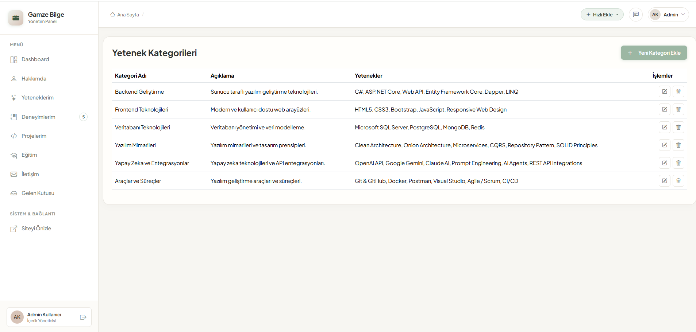

**Yetenek Ekleme**

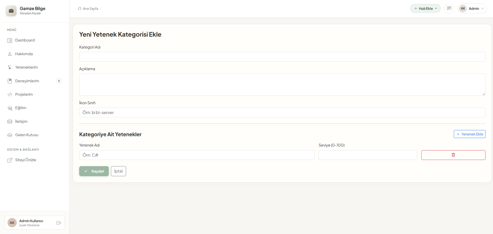

**Yetenek Güncelleme**

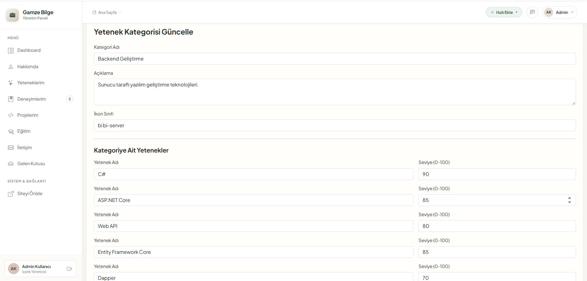

### 5. Proje Yönetimi

Portfolyoda yer alan projelerin yönetimi gerçekleştirilir.

- Proje ekleme
- Proje listeleme
- Proje güncelleme
- Proje silme
- Kategoriye göre filtreleme
- Tarihe göre sıralama
- Aktif ve pasif proje yönetimi
- Görsel yükleme
- Teknoloji bilgilerinin yönetimi

Proje görselleri yüklenirken dosya uzantısı ve boyut kontrolü yapılır.

**Proje Listesi**

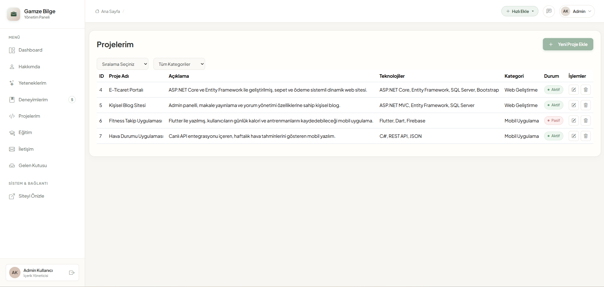

**Proje Güncelleme**

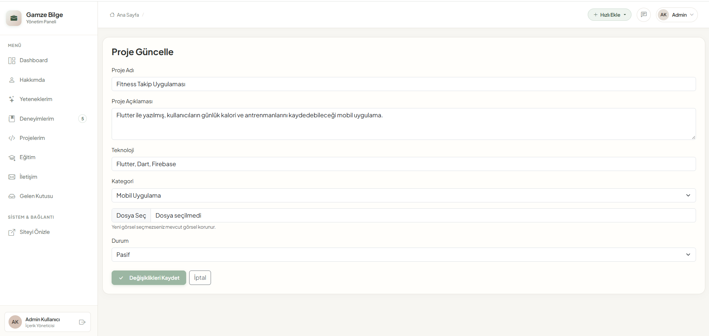

### 6. Eğitim Yönetimi

Eğitim bilgileri yönetim paneli üzerinden eklenebilir, listelenebilir, güncellenebilir ve silinebilir.

**Eğitim Listesi**

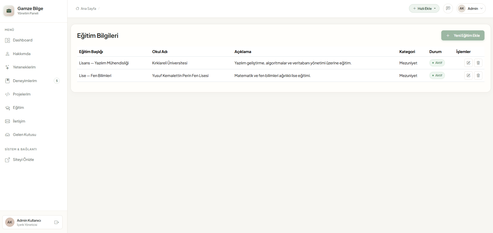

**Eğitim Güncelleme**

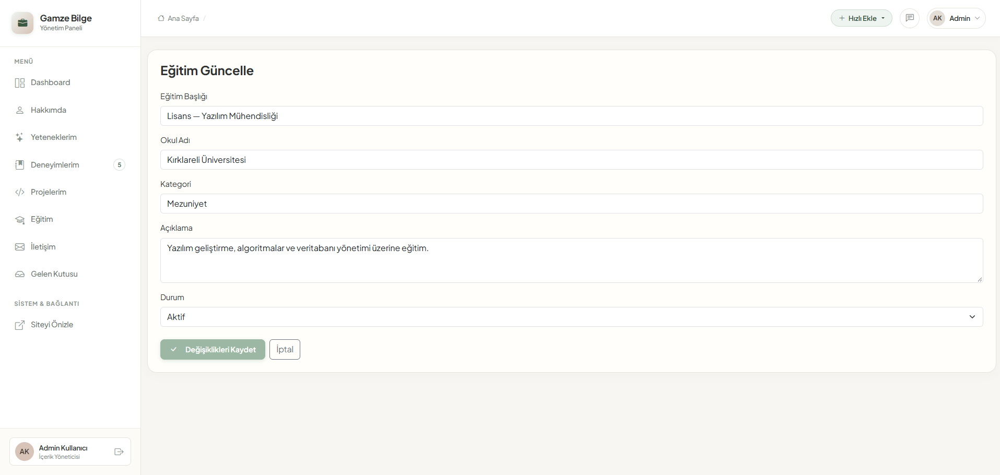

### 7. İletişim Yönetimi

İletişim bilgileri ve sosyal medya hesapları yönetilir.

- İletişim bilgilerinin görüntülenmesi
- İletişim bilgilerinin güncellenmesi
- Sosyal medya hesabı ekleme
- Sosyal medya hesabı güncelleme
- Sosyal medya hesabı silme

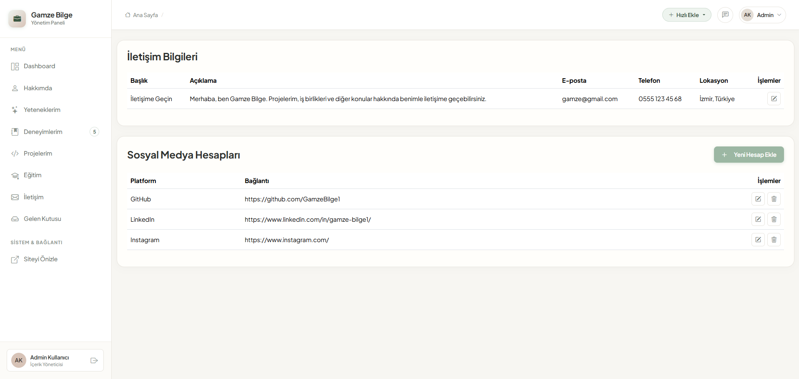

### 8. Gelen Kutusu

Ziyaretçiler tarafından gönderilen mesajlar yönetilir.

- Gelen mesajları listeleme
- Mesaj detaylarını görüntüleme
- Mesajı okundu veya okunmadı olarak işaretleme
- Mesaj güncelleme
- Mesaj silme

**Mesaj Listesi**

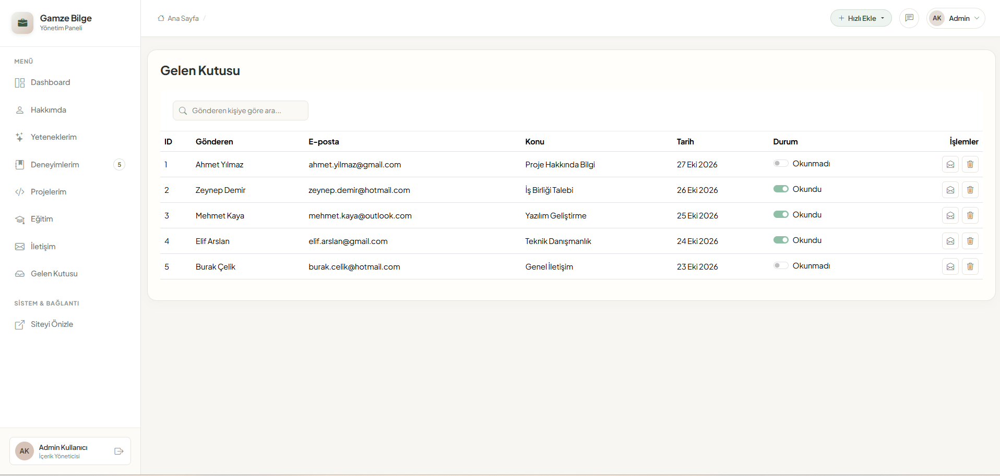

**Mesaj Detayı**

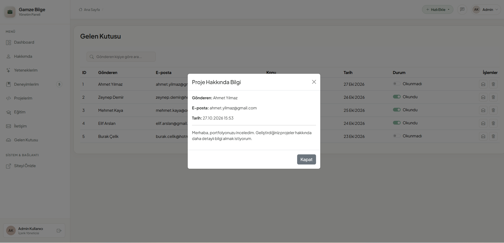

---

## ✨ Öne Çıkan Özellikler

- ViewComponent kullanılarak parçalı ve yeniden kullanılabilir sayfa yapısı oluşturulmuştur.
- Entity Framework Core ile Code First yaklaşımı uygulanmıştır.
- İlişkili veriler Include kullanılarak birlikte sorgulanmıştır.
- CRUD işlemleri geliştirilmiştir.
- Data Annotations ile model doğrulamaları uygulanmıştır.
- ModelState.IsValid ile form doğrulaması yapılmıştır.
- TempData üzerinden işlem sonuçları kullanıcıya bildirilmiştir.
- IFormFile ile proje görseli yükleme işlemi gerçekleştirilmiştir.
- Bootstrap ile responsive tasarım oluşturulmuştur.
- Dinamik navbar ve sidebar yapısı geliştirilmiştir.
- Hızlı Ekle menüsü ile yönetim işlemlerine erişim kolaylaştırılmıştır.
- Navbar üzerinden son üç mesaja hızlı erişim sağlanmıştır.
- Footer ve sosyal medya bağlantıları veritabanından dinamik olarak yönetilmiştir.
- Dashboard üzerinde veritabanından alınan istatistikler gösterilmiştir.

## 🗂️ Proje Yapısı

Proje ASP.NET Core MVC mimarisine uygun olarak düzenlenmiştir.

- **Areas/Admin:** Yönetim paneline ait Controller ve View dosyaları.
- **Context:** Entity Framework Core veritabanı bağlantısı.
- **Entities:** Veritabanı entity sınıfları.
- **Migrations:** Code First migration dosyaları.
- **ViewComponents:** Kullanıcı arayüzü ve yönetim paneli için yeniden kullanılabilir bileşenler.
- **Views:** Kullanıcı arayüzüne ait sayfalar.
- **wwwroot:** CSS, JavaScript, kütüphaneler ve proje görselleri.
- **Images:** Proje ekran görüntüleri.

## 🛠️ Kurulum

1. Repository'yi bilgisayarınıza klonlayın.

```bash
git clone https://github.com/GamzeBilge1/MYAcademy_PortfolioProject.git
```

2. Solution dosyasını Visual Studio ile açın.

3. SQL Server bağlantı ayarını kendi bilgisayarınıza göre düzenleyin.

4. Package Manager Console üzerinden migration işlemlerini uygulayın.

```powershell
Update-Database
```

5. Projeyi çalıştırın.

```bash
dotnet run
```

## 👩‍💻 Geliştirici


**Gamze Bilge**

[GitHub Hesabım](https://github.com/GamzeBilge1)  
[LinkedIn Hesabım](LINKEDIN_PROFIL_LINKIN)


